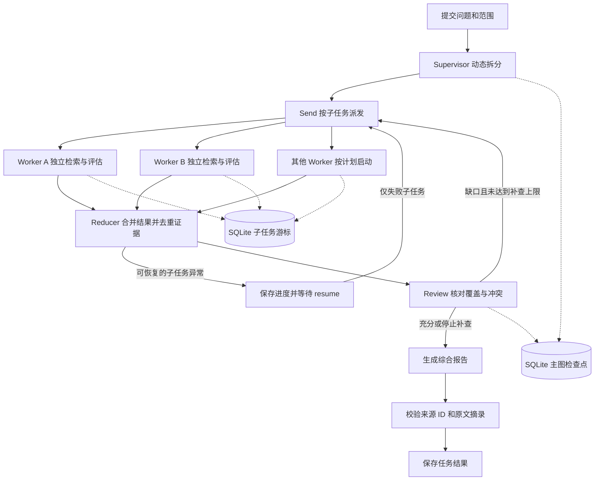
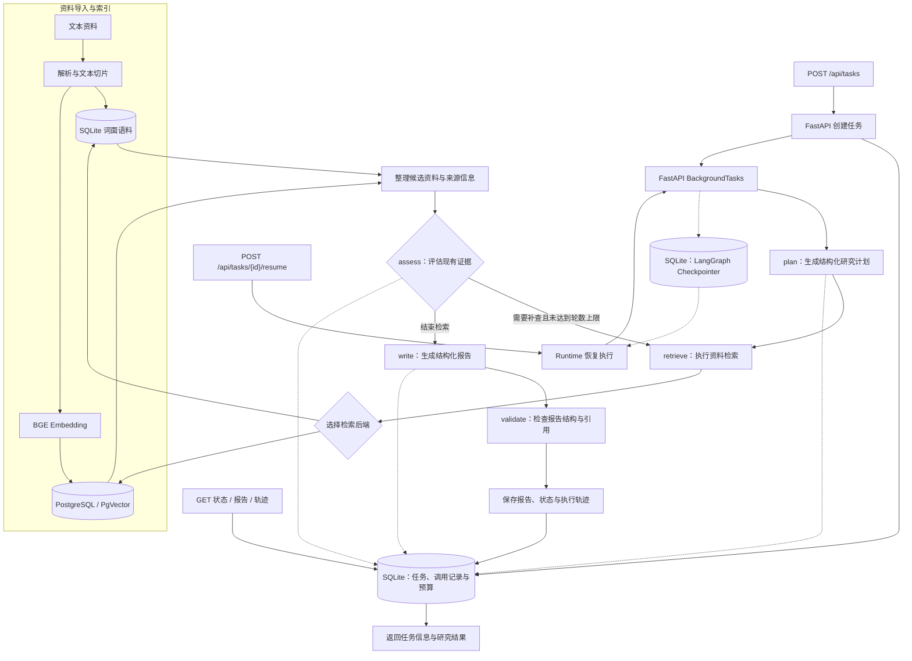

# ResearchPilot: Evidence-Grounded Research Platform

**ResearchPilot：多智能体协作式企业调研与报告生成平台**

面向企业技术选型与多文档调研的 Python 项目。通过 FastAPI 提交问题，使用 LangGraph 编排检索、补查与报告生成，并附上可追溯的来源和摘录。

## 企业研究与执行模式

ResearchPilot 面向企业技术选型、内部多文档调研、竞品与供应商方案比较。研究员可以提交一个问题和业务约束，系统从已导入的资料中收集摘录，生成可以追溯来源的决策辅助报告，并列出缺少证据的事项。

| 模式 | 执行方式 | 适合的问题 |
|---|---|---|
| `single`（默认） | 原五节点图在同一上下文内规划、循环检索、判断证据、写作和校验 | 单文档总结、目标集中的资料核对 |
| `multi` | Supervisor 动态规划，LangGraph `Send` 并行派发独立 Worker 子图，Review 检查全局缺口并定向补查 | 多候选、多维度、需要独立资料路径的技术选型 |



- **Supervisor** 用 Pydantic 校验目标、范围、维度、约束与查询，按问题拆分子任务。明确列出的候选产品和维度沿用用户原词，首查按产品名发起。默认最多 4 个子任务、3 路并行，可通过 `RESEARCH_MULTI_MAX_SUBTASKS` 和 `RESEARCH_MULTI_MAX_CONCURRENCY` 在 1–6 范围内调整。
- **Research Worker** 各自保存查询、检索轮次、证据、评估结果和异常历史。复用 SQLite 词面检索或专用集合中的 PgVector/BGE 检索。多模式只查已导入资料。
- **Review** 按计划顺序合并结果，优先保留 Worker 引用过的证据，并按 locator 和摘录去重。评估原问题覆盖、缺口和可能的冲突。最多派发一批定向补查，本地检索与补查共用轮次上限；没有新证据时复用原局部评估。
- **报告** 提供有证据的候选、对比和风险信息，同时列明缺口。本地 Qwen 先选原文段落，再写这段能支持的发现。程序核对来源和原文，`facts_verified` 始终为 `false`。

### 进度、预算与恢复

`GET /api/tasks/{id}` 的 `progress` 提供主阶段、Worker 状态和已完成数、唯一证据数、补查数、预算和报告状态。每个子任务有初始与执行查询、证据、局部结论、覆盖维度、未解决问题、用量、时间和异常。主任务 `completed` 表示报告已发布，`progress.quality` 的 `full`、`partial` 或 `insufficient` 表示当前证据结论。引用校验失败会阻止发布。

多模式的所有模型尝试共用主任务的 SQLite 账本。每次请求前原子预占，Worker 给全局评估和写报告预留额度。单步超时后不采纳迟到结果，绝对时限从首次执行开始并跨恢复保留。调用数统计预占次数，Token 只采用提供方返回的数据。环境模板见 [.env.example](.env.example)。

主任务用 `task_id` 找到主图 checkpoint，子任务用 `task_id + subtask_id` 找到独立游标。`POST /api/tasks/{id}/resume` 会继续未完成工作；若首次局部失败，主图在 `waiting_for_retry` 暂停，同一轮分发允许一次手动重试。已保存的检索或已完成的子任务可直接复用。进程在模型请求和结果落盘之间中断时，请求可能重放并消耗原预算。详见[中文流程讲解](docs/MULTI_AGENT_FLOW_ZH.md)。

## 目录结构

| 位置 | 职责 |
|---|---|
| `research_pilot/api.py`、`runtime.py` | HTTP、双模式路由、后台执行和进度 |
| `research_pilot/workflow.py` | 原单 Agent 图 |
| `research_pilot/multi_workflow.py`、`multi_schema.py` | 主图、动态分发、全局 Review 和企业报告结构 |
| `research_pilot/research_agent.py` | 独立 Worker 子图、查询与轮次游标 |
| `research_pilot/store.py`、`evidence.py` | 持久化、原子预算、证据合并与引用 |
| `research_pilot/retrieval.py`、`vector.py` | 词面检索、PgVector 与 BGE |
| `tests/`、`tests_real/` | 离线回归、本地真实模型测试 |
| `benchmarks/multi_agent_v1/`、`benchmarks/zh_retrieval_v1/` | Multi-Agent 编排对照、独立中文检索评测 |

## 技术栈

| 技术                         | 用途                                     |
|:-----------------------------|:-----------------------------------------|
| Python 3.12                  | 主要开发语言                             |
| FastAPI                      | 任务提交、状态查询、报告、轨迹与恢复接口 |
| LangGraph                    | 单 Agent 基线、并行子图和条件路由   |
| LangChain、Pydantic          | 模型交互与结构化数据校验                 |
| SQLite                       | 任务记录、模型调用记录、预算及图检查点   |
| PostgreSQL、PgVector         | 可选的向量检索后端                       |
| BGE、FastEmbed、ONNX Runtime | 英文 Embedding 与语义检索                |
| PyTorch、Transformers        | 中文 Embedding 模型加载与推理            |
| Ollama、Qwen、DeepSeek       | 本地与云端模型适配                       |

依赖版本及可选安装方式见 `pyproject.toml` 和对应的依赖锁文件。

## 单 Agent 基线工作流



研究流程由五个节点组成：

1.  `plan`：根据研究问题生成结构化研究计划和待执行查询。
2.  `retrieve`：执行当前待执行查询，获取候选资料并整理来源信息。
3.  `assess`：评估当前资料是否足以支持研究；需要补充资料时生成补查查询，并通过条件边返回
    `retrieve`。
4.  `write`：根据研究状态和检索证据生成结构化报告。
5.  `validate`：检查报告结构、来源 ID 和引用摘录，校验通过后保存报告。

首轮检索执行研究计划中的第一条查询；后续补查由评估节点根据当前证据生成，单次最多增加两条补查查询。检索轮数、单轮来源数量和图递归深度均受到配置约束。

### 状态与持久化关系

- `task_id` 与 LangGraph `thread_id`
  使用同一任务标识，便于将任务记录与图执行状态关联。
- 任务 SQLite 保存任务状态、模型调用记录和调用预算。
- LangGraph Checkpointer 使用独立 SQLite 文件保存图状态与执行检查点。
- Plan、Assess 和 Write
  等模型调用共享任务预算；失败尝试同样计入预算，恢复任务不会重置已消耗额度。
- `/resume`
  根据原任务标识读取检查点并继续执行，任务状态与检查点通过运行时对账协调。

## 核心实现

### 1. LangGraph 状态管理与有限检索循环

`research_pilot/workflow.py` 使用 `StateGraph`
组织研究节点、状态传递和条件边。

各节点围绕结构化 State 协作，主要字段包括：

- `task_id`、`question`、`scope`：任务标识、研究问题与范围。
- `queries`、`iteration`：待执行查询与检索轮次。
- `sources`、`tool_errors`：累计来源和检索工具错误。
- `report`、`report_status`：报告内容与生成状态。
- `trace`、`evidence_status`、`research`：执行轨迹、证据状态和结构化研究信息。

首轮按计划执行第一条查询；评估节点判断是否需要补查，并在允许的范围内生成补充查询。流程通过最大检索轮数、来源数量限制和
LangGraph `recursion_limit` 控制执行范围。

### 2. 资料检索与向量模型管理

`research_pilot/retrieval.py` 负责检索流程，`research_pilot/vector.py`
负责 Embedding 模型和 PgVector 操作。

项目提供两类检索后端：

- **词面检索**：基于 SQLite
  本地语料执行中文字符片段和英文词项检索，不生成神经网络向量。
- **语义检索**：使用 Embedding 模型生成向量，通过 PostgreSQL + PgVector
  执行余弦距离检索。

当前支持的向量模型配置：

| 模型                     | 推理方式                 | 向量维度 |
|:-------------------------|:-------------------------|:--------:|
| `BAAI/bge-small-en-v1.5` | FastEmbed / ONNX Runtime |   384    |
| `BAAI/bge-small-zh-v1.5` | PyTorch / Transformers   |   512    |

向量集合按模型身份和维度隔离。切换 Embedding
模型后，需要使用匹配的模型配置和向量集合重新导入资料。检索结果保留文档、分片、来源定位、查询和检索时间等元数据，供报告引用与执行轨迹使用。

### 3. 来源标识与引用摘录校验

`research_pilot/evidence.py` 合并来源并校验引用 ID。
`research_pilot/local_llm.py` 校验结构化报告的原文摘录和证据充分性标记，
`research_pilot/schema.py` 与 `research_pilot/multi_schema.py` 定义数据结构。

- 检索来源使用稳定的 `S1`、`S2` 等标识。
- 来源去重依据 locator 和 excerpt。
- 报告中的 `source_id` 必须属于本轮允许的检索来源集合。
- 报告引用摘录会与对应检索记录中的原文进行匹配检查。
- 结构化报告需要满足预定义 Schema。

系统将引用
ID/摘录校验与人工事实核查分开记录。引用校验用于确认报告引用对应实际检索材料；人工事实核查状态独立保存，不会因为引用格式通过就自动标记为事实已核实。

### 4. 任务持久化、调用预算与手动恢复

`research_pilot/runtime.py`
负责任务执行与运行时控制，`research_pilot/store.py`
管理任务状态、调用记录和相关持久化数据。

任务通过 `task_id` 与 LangGraph 的 `thread_id`
关联。任务记录、模型调用记录和预算保存在任务 SQLite 中；LangGraph
Checkpointer 使用独立 SQLite 文件保存图状态。

运行时对模型调用次数、任务总时限、节点执行时间和输出长度设置上限。失败尝试同样占用模型调用预算，恢复任务继续使用原任务的预算记录。

系统提供手动 `POST /api/tasks/{id}/resume` 接口。恢复时，Runtime
读取原任务的图检查点，并对任务记录、来源和执行轨迹进行状态对账。进程重启后，未完成任务通过该接口显式恢复。

### 5. 本地与云端模型适配

项目通过统一模型适配入口支持不同运行方式：

| 模式          | 作用                                                     |
|:--------------|:---------------------------------------------------------|
| Mock          | 离线演示任务流转、接口行为和状态管理                     |
| Ollama / Qwen | 使用本地模型完成结构化计划、检索评估和报告生成           |
| DeepSeek      | 调用云端模型接口，需要配置 API Key，并按实际调用产生费用 |

`research_pilot/local_llm.py` 和 `research_pilot/deepseek.py`
负责相应模型调用与错误处理，`research_pilot/model.py` 提供模型适配入口。

模型输出经过结构化解析与 Pydantic 校验。对于非法
JSON、格式不符、截断、认证失败、限流或超时等情况，系统将其转换为受控错误，并记录相应任务状态和调用信息。

## HTTP API

| 接口                          | 功能                 |
|:------------------------------|:---------------------|
| `GET /health`                 | 检查应用进程状态     |
| `POST /api/documents/text`    | 导入文本资料         |
| `POST /api/tasks`             | 提交研究任务         |
| `GET /api/tasks/{id}`         | 查询任务状态         |
| `GET /api/tasks/{id}/report`  | 获取已完成的研究报告 |
| `GET /api/tasks/{id}/trace`   | 查看节点轨迹         |
| `POST /api/tasks/{id}/resume` | 手动恢复任务         |

新任务提交后返回任务
ID，客户端可以轮询任务状态。报告完成并通过校验后，可通过 `/report`
获取，执行过程可通过 `/trace` 查看。
提交时用 `mode: "multi"` 启动并行研究，省略 `mode` 使用 `single`。

## 本地运行

### 环境要求

- Python 3.12
- 可选：Docker 与 Docker Compose
- 可选：PostgreSQL + PgVector
- 可选：本地 Ollama 模型或云端模型 API Key

### 1. 创建 Python 环境

在仓库根目录执行：

``` powershell
python -m venv .venv

.\.venv\Scripts\python.exe -m pip install -r requirements.lock

.\.venv\Scripts\python.exe -m pip install --no-deps -e .
```

### 2. 启动离线演示

``` powershell
$env:RESEARCH_MODEL_BACKEND = "mock"
$env:RESEARCH_SEARCH_BACKEND = "none"
$env:RESEARCH_RETRIEVAL_BACKEND = "lexical"
$env:RESEARCH_DATA_DIR = "./data/multi-agent-demo"
$env:RESEARCH_MAX_MODEL_CALLS = "8"
$env:RESEARCH_RETRIEVAL_TOP_K = "1"

.\.venv\Scripts\python.exe -m uvicorn research_pilot.api:app --host 127.0.0.1 --port 8010
```

打开 `http://127.0.0.1:8010/docs` 查看接口。

也可以在 Docker 环境中运行：

``` bash
docker compose up --build
```

默认 Compose 演示使用 Mock
模型和词面检索，服务绑定本机回环地址，不需要云端模型密钥。

### 3. 导入资料并提交任务

以下 PowerShell 示例使用公开的合成资料：

``` powershell
$base = "http://127.0.0.1:8010"

$doc = @{
    title = "演示资料"
    content = "演示组件使用检查点保存研究线程状态。"
    source_ref = "synthetic:readme-demo"
} | ConvertTo-Json

Invoke-RestMethod `
    -Method Post `
    -Uri "$base/api/documents/text" `
    -ContentType "application/json; charset=utf-8" `
    -Body ([Text.Encoding]::UTF8.GetBytes($doc))

$request = @{
    question = "演示组件怎样保存研究线程状态？"
} | ConvertTo-Json

$task = Invoke-RestMethod `
    -Method Post `
    -Uri "$base/api/tasks" `
    -ContentType "application/json; charset=utf-8" `
    -Body ([Text.Encoding]::UTF8.GetBytes($request))

Invoke-RestMethod "$base/api/tasks/$($task.task_id)"
```

任务完成后，可以通过以下接口获取报告和执行轨迹：

``` powershell
Invoke-RestMethod "$base/api/tasks/$($task.task_id)/report"
Invoke-RestMethod "$base/api/tasks/$($task.task_id)/trace"
```

### 演示企业 RAG 知识库技术选型

先启动上面的 Mock 服务，再在另一个终端提交合成技术选型任务。该配置便于观察 PgVector 的定向补查。

```powershell
$base = 'http://127.0.0.1:8010'
$dataset = Get-Content -Encoding utf8 benchmarks/multi_agent_v1/dataset.json -Raw | ConvertFrom-Json
$case = $dataset.cases | Where-Object id -EQ 'rag'
function Submit-ResearchJson($path, $body) {
    $json = $body | ConvertTo-Json -Depth 8
    Invoke-RestMethod -Method Post -Uri "$base$path" -ContentType 'application/json; charset=utf-8' -Body ([Text.Encoding]::UTF8.GetBytes($json))
}
foreach ($doc in $case.documents) {
    Submit-ResearchJson '/api/documents/text' @{title=$doc.title; content=$doc.content; source_ref=$doc.id}
}
$task = Submit-ResearchJson '/api/tasks' @{question=$case.question; scope=$case.scope; mode='multi'}
$path = "$base/api/tasks/$($task.task_id)"
do {
    $status = Invoke-RestMethod $path
    $status.progress | Select-Object phase,completed_subtask_count,evidence_count,model_calls,quality
    if ($status.status -notin 'pending','running') { break }
    Start-Sleep -Milliseconds 300
} while ($true)
if ($status.status -eq 'completed') {
    (Invoke-RestMethod "$path/report").markdown
}
```

对照调用把 `mode` 改为 `single` 即可。演示资料均为合成企业试点纪要，适用于展示范围与证据，价格或通用性能需要另行实测。

### 4. 启用中文向量检索

中文向量检索需要准备 `requirements-chinese.lock`、中文 Embedding 模型和
PgVector 环境，并按照 [演示指南](docs/DEMO_GUIDE.md)
配置数据库连接与独立集合。

修改模型或检索配置后，需要重新导入相应资料。默认词面检索模式使用 SQLite
本地语料，不会自动切换为中文向量检索。

### 5. 配置真实模型

使用 Ollama 时，需要先准备本地模型并设置对应的模型地址；使用 DeepSeek
时，需要显式启用相应 Provider，并通过进程环境注入 API Key。

不要将真实 API Key 写入代码、提交到 `.env.example`
或放入公开测试数据中。真实模型调用与默认离线演示分别执行。

## 测试与验证

项目测试覆盖研究工作流、结构化输出、来源校验、向量检索、HTTP
接口、任务持久化、预算控制、超时与恢复等部分。

### 1. 自动化回归

| 测试范围 | 实际结果 |
|---|---|
| 完整默认回归 | 124 通过，0 失败，0 跳过 |
| 多 Agent 专项 | 24 通过 |
| 本地真实 Qwen 套件 | 7 通过，0 失败，0 跳过。历史失败的 B/E 通过原断言 |

默认回归覆盖业务逻辑、HTTP 合约、BGE/PgVector、SQLite 并发预算与独立进程恢复。运行条件和命令见[发布验收](docs/MULTI_AGENT_ACCEPTANCE_ZH.md)。本地 Qwen 和 Mock 评测分别执行。

### 2. 中文语义检索评测

基于固定检索基准比较英文 BGE 与官方中文 BGE。评测集包含 19 篇文档、20
道问题，其中 16 道有答案、4 道无答案，另有 4 道需要多文档证据。

| 评价指标         | 英文 BGE（384D） | 中文 BGE（512D，无查询指令） |
|:-----------------|:----------------:|:----------------------------:|
| Recall@5         |     53.125%      |             100%             |
| MRR@5            |      51.04%      |           96.875%            |
| 多文档完整覆盖@5 |       0/4        |             4/4              |
| 无答案问题零候选 |       0/4        |             1/4              |

中文模型在该固定测试集上提升了相关文档召回和多文档覆盖效果。4
道无答案问题中，中文模型仍有 3
道返回候选资料，因此检索指标用于衡量候选资料召回，不等同于最终回答准确率或正确拒答率。

### 3. Multi-Agent Mock 对照实验

相同的两道多文档企业题、相同 Mock 模型和 SQLite 资料库，每组 6 次常规运行。预算均为最多 8 次模型尝试，检索候选为 Top-1。在此固定样本中：

| 指标 | A 原单 Agent | B 固定并行、无补查 | C 动态多 Agent |
|---|---:|---:|---:|
| 关键证据覆盖 | 12/21（57.1%） | 15/21（71.4%） | 21/21（100%） |
| 研究维度覆盖 | 27/54（50.0%） | 48/54（88.9%） | 54/54（100%） |
| 有效引用（报告实际生成） | 12/12 | 15/15 | 21/21 |
| 平均模型调用尝试 | 4 | 5.5 | 7.5 |

三组均完成报告。RAG 用例注入一次评估异常后，三组均可恢复且未重跑已持久化的检索。C 恢复后按剩余额度生成部分报告。耗时、逐次结果和 Token 口径见[实验说明](benchmarks/multi_agent_v1/README.md)和[原始 JSON](benchmarks/multi_agent_v1/results.json)。这组 Mock 结果衡量编排效果，中文 BGE 检索历史评测和真实模型验收单独记录。

```powershell
.\.venv\Scripts\python.exe -m pytest -q
.\.venv\Scripts\python.exe -m pytest -q tests/test_multi_agent.py
.\.venv\Scripts\python.exe -X utf8 scripts/evaluate_multi_agent.py --output data/multi-agent-eval.json
```

完整回归还需要现有中文和英文模型缓存，以及已启动的专用 PgVector 测试服务。测试验收、真实模型运行与限制见[多智能体开发验收](docs/MULTI_AGENT_ACCEPTANCE_ZH.md)。

发布前默认回归 **124 项通过**，另有本地真实 Qwen **7 项通过**，包括历史失败的 B/E。最终 RAG 复查在 8 次调用内取到 4/4 关键材料并输出 7 条有效引用。严格人工复核只有 1 条结论完整获证，报告标记为部分完成。[真实 A/B/C、三类验收与人工复核](benchmarks/multi_agent_v1/REAL_QWEN_REVIEW_20261125.md)

### 4. 历史模型验收

以下为升级前的原始验收。新版本的本地 Qwen 套件结果见上文，历史失败记录仍可追溯。

| 模型与场景           | 验证结果                                                  |
|:---------------------|:----------------------------------------------------------|
| Qwen3 4B：A、C、D、F | 流程验证通过                                              |
| Qwen3 4B：B、E       | 出现过度拒答，作为已知失败保留                            |
| DeepSeek：A          | 单文档真实 HTTP、BGE/PgVector、引用与 SQLite 查询闭环通过 |
| DeepSeek：B          | 两轮检索，4 次 HTTP 200；三条结论由正常来源支持           |
| DeepSeek：E          | 一轮检索，3 次 HTTP 200；三条结论由正常来源支持           |

DeepSeek B/E 共完成 7 次请求，累计 6,028
Token。两项任务均完成报告生成与校验，任务记录、SQLite 预算、LangGraph
Checkpointer 和 API
查询结果保持一致；重新查询没有增加模型请求次数。DeepSeek C、D、F
尚未单独进行真实模型验收。

当前记录将来源 ID/摘录校验与人工事实核查分开保存：真实验收报告中的
`facts_verified=false` 和 `fact_review=pending_manual_review`
状态保持不变。

## 使用边界

HTTP 服务面向本机演示。当前实现采用单服务和显式手动恢复。企业认证、租户隔离与分布式调度未纳入实现。外部模型调用在崩溃后可能重放并继续扣用原预算。引用匹配只验证来源和摘录，真实报告仍需人工判断结论是否获证。

## 许可证与第三方来源

本项目采用 MIT License。工作流设计参考 [LangChain Open Deep
Research](https://github.com/langchain-ai/open_deep_research)，并保留相应的第三方来源说明。

项目使用的模型权重、运行时、向量检索组件和 Python
依赖均有各自的许可要求。模型权重需按项目文档单独下载，不属于本仓库源码的一部分。

- [多 Agent 流程与面试指南](docs/MULTI_AGENT_FLOW_ZH.md)
- [简历事实依据](docs/RESUME_FACTS_ZH.md)
- [原单 Agent 架构归档](ARCHITECTURE.md)
- [开发说明](DEVELOPMENT.md)
- [演示指南](docs/DEMO_GUIDE.md)
- [测试报告](TEST_REPORT.md)
- [第三方来源与许可](THIRD_PARTY_NOTICES.md)
