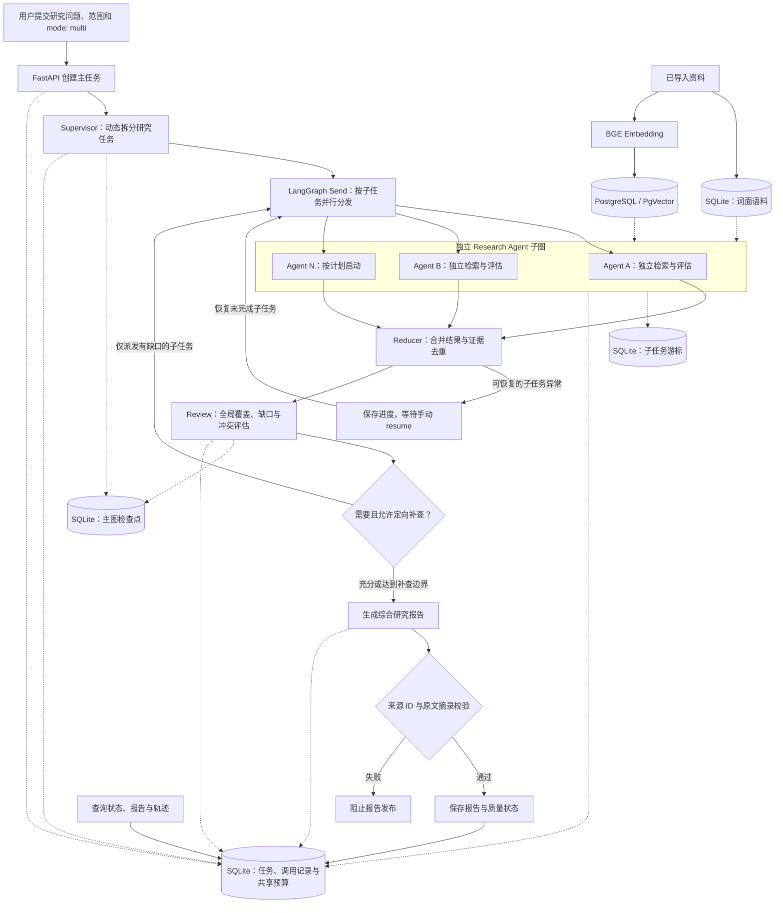
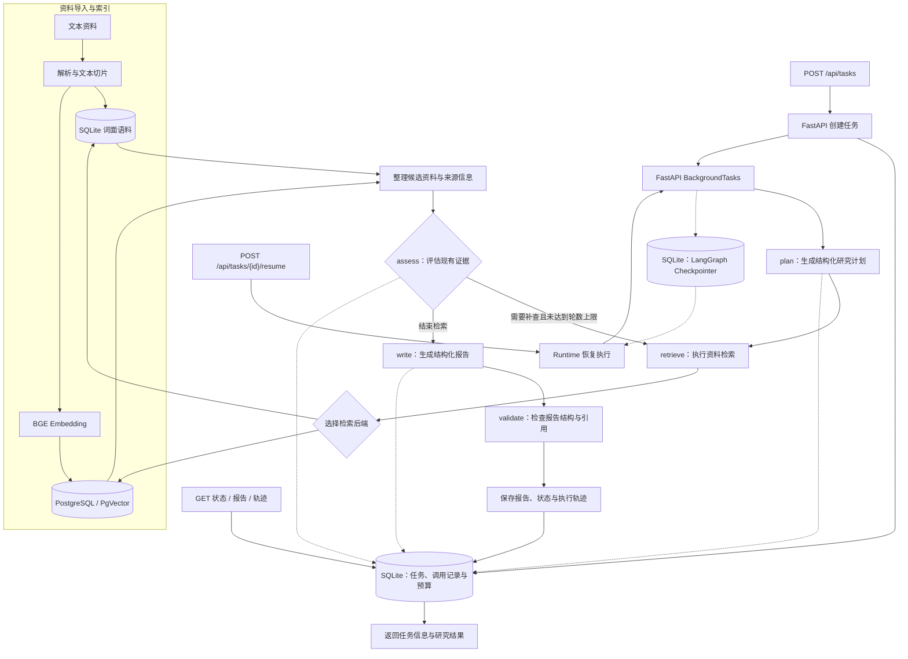

# ResearchPilot：多智能体自主调研与报告生成平台

[AI 应用实践案例](docs/AI_APPLICATION_CASE_ZH.md) · 项目场景、开发过程与实测结果

## 项目简介

基于 Python、FastAPI、LangChain 和 LangGraph 构建的多智能体研究平台，面向企业技术选型、多文档资料调研和决策辅助场景。系统根据研究需求动态拆分子任务，协调多个 Research Agent 并行检索与评估证据，对存在缺口的研究方向定向补查，最终生成附有来源和原文摘录的研究报告。

> 支持 `single`（默认）与 `multi` 两种执行模式。多 Agent 模式基于已导入资料研究，报告用于辅助决策。

## 核心特性

- **多智能体协作：** 采用 Supervisor-Worker 架构，通过 LangGraph `Send` 动态分发任务，使用独立子图执行研究，并合并结果。
- **动态补充检索：** 结合局部证据评估与全局 Review，识别缺口并仅对相关子任务补查。
- **双模式执行：** 保留原五节点单 Agent 工作流，复杂调研可显式启用多 Agent 模式。
- **中文语义检索：** 支持中文 BGE 与 PostgreSQL / PgVector，也支持无需向量模型的 SQLite 词面检索。
- **全局预算与中断恢复：** 并发模型调用共享 SQLite 原子预算，结合主图检查点和子任务游标恢复已保存进度。
- **引用溯源与进度查询：** 校验来源 ID 与原文摘录，记录子任务状态、证据、调用次数及执行轨迹。

## 应用场景与执行模式

例如，企业研发团队需要比较 PgVector、Milvus 与 Elasticsearch 的检索能力、部署成本、扩展能力和维护难度。研究人员提交问题、业务约束和已导入的技术资料，系统按候选方案拆分研究任务，汇总各方向的证据并识别缺口，形成可追溯的选型辅助报告。

同一平台也可用于企业内部多文档调研、竞品分析和供应商方案比较。仓库提供合成资料供本地演示。

| 模式 | 执行方式 | 适合的问题 |
|---|---|---|
| `single`（默认） | 在同一研究上下文中规划、循环检索、评估、写作及校验 | 单文档总结、目标集中的资料核对 |
| `multi` | 动态拆分、独立 Worker 子图并行、全局评估与定向补查 | 多候选、多维度、可拆解的复杂调研 |

## 系统架构

### 多 Agent 主工作流与数据存储



主图负责协调任务与全局判断。各 Worker 独立维护查询、检索轮次、证据和评估状态，共享资料库和主任务调用预算。研究结束后，主图生成综合报告并以程序校验引用。

### 研究过程

| 阶段 | 实际处理 |
|---|---|
| Supervisor | 通过 Pydantic 校验目标、范围、维度、约束和查询；保留用户明确给出的候选及维度，动态生成子任务 |
| Research Agent（Worker） | 通过独立子图进行检索与证据评估，维护各自的查询、检索轮次、证据和异常历史 |
| 证据汇总 | 按计划顺序合并结果，优先保留 Worker 引用的证据，按 locator 和摘录去重 |
| Review | 评估原问题覆盖、缺口和可能冲突；最多派发一批定向补查，不重跑无缺口的子任务 |
| 报告与校验 | 生成候选对比、风险及证据缺口；核对来源 ID 和原文摘录，引用校验失败阻止发布 |

默认最多 4 个子任务、3 路并行，可通过 `RESEARCH_MULTI_MAX_SUBTASKS` 与 `RESEARCH_MULTI_MAX_CONCURRENCY` 在 1–6 范围内调整。局部检索与定向补查共用轮次上限；无新增证据时复用已有局部评估，为全局复核和写作保留预算。

### 全局预算、进度查询与子任务级恢复

`GET /api/tasks/{id}` 的 `progress` 提供主阶段、Worker 状态、已完成子任务数、唯一证据数、补查数、调用预算和报告状态。`completed` 表示报告已发布，`progress.quality` 的 `full`、`partial` 或 `insufficient` 表示证据质量状态，并不意味着事实全部正确。

所有模型尝试共用主任务 SQLite 账本，调用前原子检查并预占额度，为全局复核和报告生成预留预算。失败尝试也占用额度；单步超时后不采纳迟到结果，总时限跨恢复保留。Token 只记录提供方实际返回的数据。

主任务通过 `task_id` 定位主图 checkpoint，子任务通过 `task_id + subtask_id` 定位独立游标。首次局部失败可使主图进入 `waiting_for_retry`，通过 `POST /api/tasks/{id}/resume` 手动恢复；同一轮分发允许一次手动重试。已持久化的检索和已完成子任务可复用。模型请求与结果落盘之间发生崩溃时，请求仍可能重放并消耗原预算，不保证外部调用 exactly-once。

### 单 Agent 基线工作流

保留原有 `single` 工作流：Plan → Retrieve → Assess → Write → Validate；证据不足时由 Assess 生成补查查询并回到 Retrieve。它与多 Agent 模式共用任务管理、检索、模型适配和引用校验，整个研究过程沿用同一上下文。

<details>
<summary>展开原单 Agent 完整架构图与执行说明</summary>



首轮检索执行研究计划中的第一条查询，后续由评估节点生成补查查询，单次最多增加两条。检索轮数、单轮来源数量和图递归深度均受配置约束。任务记录和模型预算存入任务 SQLite，LangGraph Checkpointer 使用独立 SQLite 文件。手动恢复使用原任务标识和预算。

</details>

## 技术栈

| 技术                         | 用途                                     |
|:-----------------------------|:-----------------------------------------|
| Python 3.12                  | 运行环境                             |
| FastAPI                      | 任务提交、状态查询、报告、轨迹与恢复接口 |
| LangGraph                    | 单 Agent 基线、并行子图和条件路由   |
| LangChain、Pydantic          | 模型交互与结构化数据校验                 |
| SQLite                       | 任务记录、模型调用记录、预算及图检查点   |
| PostgreSQL、PgVector         | 可选的向量检索后端                       |
| 英文 BGE、FastEmbed、ONNX Runtime | 英文向量生成                |
| 中文 BGE、PyTorch、Transformers | 中文向量生成            |
| Ollama、Qwen、DeepSeek       | 本地与云端模型适配                       |

依赖版本及可选安装方式见 `pyproject.toml` 和对应的依赖锁文件。

## 目录结构

| 位置 | 职责 |
|---|---|
| `research_pilot/api.py`、`runtime.py` | HTTP、双模式路由、后台执行和进度 |
| `research_pilot/workflow.py` | 原单 Agent 图 |
| `research_pilot/multi_workflow.py`、`multi_schema.py` | 主图、动态分发、全局 Review 和企业报告结构 |
| `research_pilot/research_agent.py` | 独立 Worker 子图、查询与轮次游标 |
| `research_pilot/store.py`、`evidence.py` | 持久化、原子预算、证据合并与引用 |
| `research_pilot/retrieval.py`、`vector.py` | 词面检索、PgVector 与 BGE |
| `tests/`、`tests_real/` | 离线回归、本地真实模型测试 |
| `benchmarks/multi_agent_v1/`、`benchmarks/zh_retrieval_v1/` | Multi-Agent 编排对照、独立中文检索评测 |

## 检索、模型与引用校验

### 资料检索

项目支持 SQLite 词面检索和 PostgreSQL / PgVector 语义检索。词面检索使用中文字符片段与英文词项，不生成神经网络向量。向量检索使用对应 Embedding 配置计算余弦距离。

| Embedding 模型 | 推理方式 | 维度 |
|---|---|---:|
| `BAAI/bge-small-en-v1.5` | FastEmbed / ONNX Runtime | 384 |
| `BAAI/bge-small-zh-v1.5` | PyTorch / Transformers | 512 |

向量集合按模型身份和维度隔离。检索结果保留文档、分片、来源定位、查询和检索时间等信息。

### 模型适配

| 模式 | 用途 |
|---|---|
| Mock | 离线演示、编排对照和可重复测试 |
| Ollama / Qwen | 本地结构化规划、评估及报告生成 |
| DeepSeek | 云端模型接口，需 API Key，按实际调用计费 |

模型输出通过结构化解析和 Pydantic 校验。非法 JSON、格式不符、截断、认证失败、限流和超时等转换为受控错误并记录。模型适配不代表每种模型均已完成新多 Agent 架构的真实验收。

### 引用与证据校验

检索来源使用稳定标识（如 `S1`、`S2`），按 locator 和 excerpt 去重；报告中的 `source_id` 必须属于本轮允许的来源集合，并核对摘录与对应原文是否匹配。本地 Qwen 先选择具体原文段落，再生成结论。程序检查来源与摘录一致性。结论的证据支持度需要独立人工审核，程序输出的 `facts_verified` 字段为 `false`。

## HTTP API

| 接口                          | 功能                 |
|:------------------------------|:---------------------|
| `GET /health`                 | 检查应用进程状态     |
| `POST /api/documents/text`    | 导入文本资料         |
| `POST /api/tasks`             | 提交研究任务         |
| `GET /api/tasks/{id}`         | 查询任务状态         |
| `GET /api/tasks/{id}/report`  | 获取已完成的研究报告 |
| `GET /api/tasks/{id}/trace`   | 查看节点轨迹         |
| `POST /api/tasks/{id}/resume` | 手动恢复任务         |

新任务提交后返回任务 ID，客户端可以轮询任务状态。报告完成并通过校验后，可通过 `/report` 获取，执行过程可通过 `/trace` 查看。提交时用 `mode: "multi"` 启动并行研究，省略 `mode` 使用 `single`。

## 快速启动

### 环境要求

- Python 3.12
- 可选：Docker 与 Docker Compose
- 可选：PostgreSQL + PgVector
- 可选：本地 Ollama 模型或云端模型 API Key

### 1. 创建 Python 环境

在仓库根目录执行：

```powershell
python -m venv .venv

.\.venv\Scripts\python.exe -m pip install -r requirements.lock

.\.venv\Scripts\python.exe -m pip install --no-deps -e .
```

### 2. 启动服务

```powershell
$env:RESEARCH_MODEL_BACKEND = "mock"
$env:RESEARCH_SEARCH_BACKEND = "none"
$env:RESEARCH_RETRIEVAL_BACKEND = "lexical"
$env:RESEARCH_DATA_DIR = "./data/multi-agent-demo"
$env:RESEARCH_MAX_MODEL_CALLS = "8"
$env:RESEARCH_RETRIEVAL_TOP_K = "1"

.\.venv\Scripts\python.exe -m uvicorn research_pilot.api:app --host 127.0.0.1 --port 8010
```

打开 `http://127.0.0.1:8010/docs` 查看接口。

也可以在 Docker 环境中运行：

```bash
docker compose up --build
```

默认 Compose 演示使用 Mock 模型和词面检索，服务绑定本机回环地址，不需要云端模型密钥。

## 应用演示

### 导入资料并提交单 Agent 任务

以下 PowerShell 示例使用公开的合成资料：

```powershell
$base = "http://127.0.0.1:8010"

$doc = @{
    title = "演示资料"
    content = "演示组件使用检查点保存研究线程状态。"
    source_ref = "synthetic:readme-demo"
} | ConvertTo-Json

Invoke-RestMethod `
    -Method Post `
    -Uri "$base/api/documents/text" `
    -ContentType "application/json; charset=utf-8" `
    -Body ([Text.Encoding]::UTF8.GetBytes($doc))

$request = @{
    question = "演示组件怎样保存研究线程状态？"
} | ConvertTo-Json

$task = Invoke-RestMethod `
    -Method Post `
    -Uri "$base/api/tasks" `
    -ContentType "application/json; charset=utf-8" `
    -Body ([Text.Encoding]::UTF8.GetBytes($request))

Invoke-RestMethod "$base/api/tasks/$($task.task_id)"
```

任务完成后，可以通过以下接口获取报告和执行轨迹：

```powershell
Invoke-RestMethod "$base/api/tasks/$($task.task_id)/report"
Invoke-RestMethod "$base/api/tasks/$($task.task_id)/trace"
```

### 演示企业 RAG 知识库技术选型

先启动上面的 Mock 服务，再在另一个终端提交合成技术选型任务。该配置便于观察 PgVector 的定向补查。

```powershell
$base = 'http://127.0.0.1:8010'
$dataset = Get-Content -Encoding utf8 benchmarks/multi_agent_v1/dataset.json -Raw | ConvertFrom-Json
$case = $dataset.cases | Where-Object id -EQ 'rag'
function Submit-ResearchJson($path, $body) {
    $json = $body | ConvertTo-Json -Depth 8
    Invoke-RestMethod -Method Post -Uri "$base$path" -ContentType 'application/json; charset=utf-8' -Body ([Text.Encoding]::UTF8.GetBytes($json))
}
foreach ($doc in $case.documents) {
    Submit-ResearchJson '/api/documents/text' @{title=$doc.title; content=$doc.content; source_ref=$doc.id}
}
$task = Submit-ResearchJson '/api/tasks' @{question=$case.question; scope=$case.scope; mode='multi'}
$path = "$base/api/tasks/$($task.task_id)"
do {
    $status = Invoke-RestMethod $path
    $status.progress | Select-Object phase,completed_subtask_count,evidence_count,model_calls,quality
    if ($status.status -notin 'pending','running') { break }
    Start-Sleep -Milliseconds 300
} while ($true)
if ($status.status -eq 'completed') {
    (Invoke-RestMethod "$path/report").markdown
}
```

对照调用把 `mode` 改为 `single` 即可。演示资料均为合成企业试点纪要，适用于展示范围与证据，价格或通用性能需要另行实测。

## 测试与评测

项目测试覆盖研究工作流、结构化输出、来源校验、向量检索、HTTP 接口、任务持久化、预算控制、超时与恢复等部分。

### 1. 自动化回归

| 测试范围 | 实际结果 |
|---|---|
| 完整默认回归 | 124 通过，0 失败，0 跳过 |
| 多 Agent 专项 | 24 通过 |
| 本地真实 Qwen 套件 | 7 通过，0 失败，0 跳过。历史失败的 B/E 通过原断言 |

默认回归覆盖业务逻辑、HTTP 合约、BGE/PgVector、SQLite 并发预算与独立进程恢复。完整测试需准备中英文模型缓存和专用 PgVector 测试服务。真实 Qwen 套件另行运行，环境条件和完整命令见[发布验收](docs/MULTI_AGENT_ACCEPTANCE_ZH.md)。

```powershell
.\.venv\Scripts\python.exe -m pytest -q
.\.venv\Scripts\python.exe -m pytest -q tests/test_multi_agent.py
```

### 2. 中文语义检索评测

基于固定检索基准比较英文 BGE 与官方中文 BGE。评测集包含 19 篇文档、20 道问题（16 道可回答、4 道无答案），其中 4 道为多文档题。

| 评价指标         | 英文 BGE（384D） | 中文 BGE（512D，无查询指令） |
|:-----------------|:----------------:|:----------------------------:|
| Recall@5         |     53.125%      |             100%             |
| MRR@5            |      51.04%      |           96.875%            |
| 多文档完整覆盖@5 |       0/4        |             4/4              |
| 无答案问题零候选 |       0/4        |             1/4              |

中文模型在该固定测试集上提升了相关文档召回和多文档覆盖效果。4 道无答案问题中，中文模型仍有 3 道返回候选资料，因此检索指标用于衡量候选资料召回，不等同于最终回答准确率或正确拒答率。

### 3. Multi-Agent Mock 对照实验

相同的两道多文档企业题、相同 Mock 模型和 SQLite 资料库，每组 6 次常规运行。预算均为最多 8 次模型尝试，检索候选为 Top-1。在此固定样本中：

| 指标 | A 原单 Agent | B 固定并行、无补查 | C 动态多 Agent |
|---|---:|---:|---:|
| 关键证据覆盖 | 12/21（57.1%） | 15/21（71.4%） | 21/21（100%） |
| 研究维度覆盖 | 27/54（50.0%） | 48/54（88.9%） | 54/54（100%） |
| 有效引用（报告实际生成） | 12/12 | 15/15 | 21/21 |
| 平均模型调用尝试 | 4 | 5.5 | 7.5 |
| 耗时中位数（Mock） | 73.30 ms | 103.56 ms | 131.55 ms |

三组均完成报告。RAG 用例注入一次评估异常后，三组均可恢复且未重跑已持久化的检索。C 恢复后按剩余额度生成部分报告。耗时、逐次结果和 Token 口径见[实验说明](benchmarks/multi_agent_v1/README.md)和[原始 JSON](benchmarks/multi_agent_v1/results.json)。在这些合成题中，动态编排提高了覆盖率，也增加了模型调用次数和耗时。真实模型结果见下一节。

```powershell
.\.venv\Scripts\python.exe -X utf8 scripts/evaluate_multi_agent.py --output data/multi-agent-eval.json
```

### 4. 当前版本真实模型验收

最终 RAG 复查在 8 次调用内取到 4/4 关键材料并输出 7 条与原文匹配的引用。严格人工复核只有 1 条结论完整相关且获证，报告标记为部分完成。真实 Qwen 可比 A/B/C 运行的关键材料覆盖分别为 2/4、3/4、3/4；最终 C 单独复查取得 4/4，不能与先前 A/B 直接作同条件优势比较。现有样本不足以证明真实模型质量有稳定提升。[真实 A/B/C、三类验收与人工复核](benchmarks/multi_agent_v1/REAL_QWEN_REVIEW_20261125.md)

### 5. 历史模型验收

<details>
<summary>展开升级前 Qwen 与 DeepSeek 验收记录</summary>

以下为升级前的原始验收。新版本的本地 Qwen 套件结果见上文，历史失败记录仍可追溯。

| 模型与场景           | 验证结果                                                  |
|:---------------------|:----------------------------------------------------------|
| Qwen3 4B：A、C、D、F | 流程验证通过                                              |
| Qwen3 4B：B、E       | 出现过度拒答，作为已知失败保留                            |
| DeepSeek：A          | 单文档真实 HTTP、BGE/PgVector、引用与 SQLite 查询闭环通过 |
| DeepSeek：B          | 两轮检索，4 次 HTTP 200；三条结论由正常来源支持           |
| DeepSeek：E          | 一轮检索，3 次 HTTP 200；三条结论由正常来源支持           |

DeepSeek B/E 共完成 7 次请求，累计 6,028 Token。两项任务均完成报告生成与校验，任务记录、SQLite 预算、LangGraph Checkpointer 和 API 查询结果保持一致；重新查询没有增加模型请求次数。DeepSeek C、D、F 尚未单独进行真实模型验收。

当前记录将来源 ID/摘录校验与人工事实核查分开保存：真实验收报告中的 `facts_verified=false` 和 `fact_review=pending_manual_review` 状态保持不变。

</details>

## 配置说明与部署要求

### 中文向量检索

中文向量检索需要准备 `requirements-chinese.lock`、中文 Embedding 模型和 PgVector 环境，并按照 [演示指南](docs/DEMO_GUIDE.md) 配置数据库连接与独立集合。

修改模型或检索配置后，需要重新导入相应资料。默认词面检索模式使用 SQLite 本地语料，不会自动切换为中文向量检索。

### 模型服务

使用 Ollama 时，需要先准备本地模型并设置对应的模型地址；使用 DeepSeek 时，需要显式启用相应 Provider，并通过进程环境注入 API Key。

不要将真实 API Key 写入代码、提交到 `.env.example` 或放入公开测试数据中。真实模型调用与默认离线演示分别执行。

### 部署范围

默认 HTTP 服务绑定本机回环地址，适用于本地开发、测试与演示。服务采用单进程运行，发生中断后通过接口手动恢复。若要接入企业环境，需另行落实认证、文档权限、租户隔离和多实例调度等要求。

## 技术文档

- [多智能体执行流程](docs/MULTI_AGENT_FLOW_ZH.md)
- [单 Agent 架构归档](ARCHITECTURE.md)
- [开发环境与复现](DEVELOPMENT.md)
- [单 Agent 工程归档](docs/ENGINEERING_ARCHIVE.md)
- [演示指南](docs/DEMO_GUIDE.md)
- [多智能体验收记录](docs/MULTI_AGENT_ACCEPTANCE_ZH.md)与[历史测试报告](TEST_REPORT.md)
- [中文检索评测](benchmarks/zh_retrieval_v1/README.md)与[多智能体编排评测](benchmarks/multi_agent_v1/README.md)

## 开源许可证与第三方来源

本项目采用 [MIT License](LICENSE)。工作流设计参考 [LangChain Open Deep Research](https://github.com/langchain-ai/open_deep_research)，具体归属及许可见[第三方来源与许可](THIRD_PARTY_NOTICES.md)。

模型权重需按文档单独下载。模型、运行时、向量检索组件及 Python 依赖适用各自的许可。
