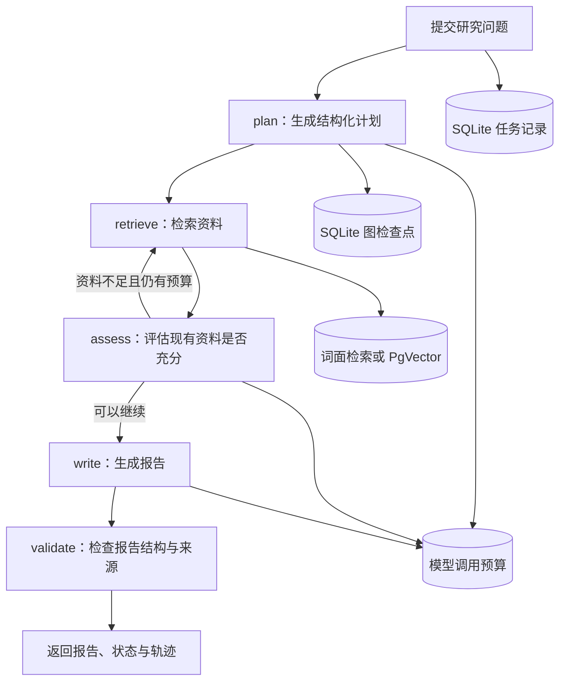

# ResearchPilot: Evidence-Grounded Research Agent

**ResearchPilot：深度研究与资料溯源智能体**

基于 Python、FastAPI 和 LangGraph 构建的深度研究智能体，将研究问题拆解为有边界的多步骤任务，通过多轮资料检索、检索结果评估、报告生成与引用来源核对，输出附有来源信息、便于核对的研究报告。

## 项目介绍

研究型任务往往需要多次检索和整理资料。一次模型调用很难同时完成问题拆解、资料收集、检索结果评估和报告生成；如果中途发生超时或进程异常，也需要能够查看任务进度并在受控条件下恢复。

ResearchPilot 使用 LangGraph 组织研究流程，并通过 FastAPI 提供任务接口。任务状态、模型调用记录和图检查点分别持久化，使研究过程能够追踪、查询和手动恢复。

项目重点包括：

- 使用结构化模型输出组织研究计划、检索结果评估和报告内容。
- 通过有限的检索回路补充资料，避免无限循环。
- 使用本地向量检索或词面检索获取相关资料。
- 将报告中的来源标识与实际检索记录对应，校验来源和摘录。
- 保存任务状态、模型调用预算和图检查点，支持手动恢复。
- 通过统一的模型适配层切换 Mock、Ollama/Qwen 和 DeepSeek。

## 技术栈

| 技术 | 用途 |
|---|---|
| Python 3.12 | 主要开发语言 |
| FastAPI | 任务提交、查询、报告与恢复接口 |
| LangGraph | 研究流程和有限状态流转 |
| LangChain、Pydantic | 模型交互与结构化数据校验 |
| SQLite | 任务、调用记录与图检查点 |
| PostgreSQL、PgVector | 可选的向量检索后端 |
| BGE、FastEmbed、ONNX Runtime | 文本向量化与语义检索 |
| PyTorch、Transformers | 可选中文 Embedding 模型加载 |
| Ollama、DeepSeek | 本地与云端模型适配 |

依赖版本及可选安装方式见 `pyproject.toml` 和对应的依赖锁文件。

## 架构与研究流程



研究流程由五个节点组成：`plan`、`retrieve`、`assess`、`write` 和 `validate`。

模型负责生成结构化计划、评估现有资料是否足以支持继续研究，并组织报告内容。资料不足时，流程可以返回检索节点进行有限补查；达到轮数、模型调用次数或任务时限上限后，流程必须结束或返回受控失败。

Mock 模式中的候选数量规则只用于演示流程控制，不代表模型真正评估了资料质量或判断了资料是否足够。

## 核心实现

### 1. LangGraph 状态管理与有限循环

`research_pilot/workflow.py` 使用 `StateGraph` 组织研究节点、状态传递和条件边。

各节点围绕结构化状态协作：

- `plan` 生成研究问题和有限的检索计划。
- `retrieve` 获取候选资料，并整理来源标识与检索信息。
- `assess` 评估当前检索结果，决定是否需要补充资料。
- `write` 根据研究状态组织结构化报告。
- `validate` 检查报告格式和引用来源。

检索循环具有明确的轮数上限。报告校验失败时，系统不会直接发布未经校验的报告。

### 2. 资料检索与向量模型管理

`research_pilot/retrieval.py` 负责检索流程，`research_pilot/vector.py` 负责向量模型和 PgVector 相关操作。

项目保留词面检索，并支持可选的语义检索后端：

- 英文向量模型使用 BGE English ONNX 资源，输出 384 维向量。
- 中文向量模型使用 `BAAI/bge-small-zh-v1.5`，输出 512 维向量。
- 向量数据存储在 PostgreSQL + PgVector 中，并按模型身份与集合配置区分索引。

中文模型需要安装对应的依赖并单独准备模型文件。切换 Embedding 模型后，应使用匹配的向量维度和集合重新导入资料，不能将旧模型的向量直接作为新模型的检索结果。

检索结果保留文档、分片、检索时间、来源定位信息和查询等元数据，便于后续核对报告引用和排查问题。

### 3. 来源与摘录校验

`research_pilot/evidence.py` 负责报告中的来源与摘录检查，`research_pilot/schema.py` 定义研究计划、资料评估和报告的数据结构。

系统检查报告使用的来源标识是否来自本轮允许的来源集合，并校验相关摘录与记录是否匹配。结构化报告还需要满足预先定义的 Schema。

这些检查可以发现无效来源 ID、缺少引用和部分结构问题，但不能保证模型对资料的解释一定正确，也不能证明每条结论都由引用内容在语义上充分支持。

项目保留 `facts_verified=false` 等未验证状态，不把格式正确或引用存在直接解释为事实已核实。

### 4. 任务持久化、调用预算与手动恢复

`research_pilot/runtime.py` 负责任务执行与运行时控制，`research_pilot/store.py` 管理任务状态、调用记录和相关持久化数据。

任务通过 `task_id` 与 LangGraph 的 `thread_id` 关联。SQLite 保存任务信息与调用预算，LangGraph Checkpointer 保存图状态，供后续查询或恢复使用。

运行时对模型调用次数、任务总时限、节点超时和输出长度设置上限。失败尝试同样占用调用预算，恢复任务不会自动重置已经消耗的预算。

系统提供手动 `/resume` 接口，用于在条件满足时继续未完成的任务。

需要注意，任务记录和图检查点位于不同的 SQLite 文件中，两者不具备跨库原子事务。项目采用状态对账和显式恢复处理不一致情况，不宣称已经实现分布式任务队列或完全自动的崩溃恢复。

### 5. 本地与云端模型适配

项目提供不同的模型运行方式：

| 模式 | 作用 |
|---|---|
| Mock | 离线演示任务流转和接口行为，不具备真实模型推理能力 |
| Ollama / Qwen | 使用本地模型完成结构化计划、检索结果评估和报告生成 |
| DeepSeek | 显式调用云端模型接口，需要安全配置 API Key，并会产生模型费用 |

`research_pilot/local_llm.py` 和 `research_pilot/deepseek.py` 负责相应的模型调用与错误处理，`research_pilot/model.py` 负责模型适配入口。

模型输出会经过结构化解析与 Pydantic 校验。对于非法 JSON、格式不符、截断、认证失败、限流或超时等情况，系统将其转化为受控错误，而不是把异常原文直接当作有效报告。

本地模型与云端模型使用同一套研究工作流，但不同模型对检索结果的评估和拒答行为并不相同。通过结构化输出只能约束结果格式，不能保证模型生成内容的真实性。

## HTTP API

| 接口 | 功能 |
|---|---|
| `GET /health` | 检查应用进程状态 |
| `POST /api/documents/text` | 导入文本资料 |
| `POST /api/tasks` | 提交研究任务 |
| `GET /api/tasks/{id}` | 查询任务状态 |
| `GET /api/tasks/{id}/report` | 获取已完成的研究报告 |
| `GET /api/tasks/{id}/trace` | 查看节点轨迹 |
| `POST /api/tasks/{id}/resume` | 手动恢复任务 |

新任务提交后返回任务 ID，客户端可以轮询任务状态。报告尚未完成时，报告接口不会将未完成任务当作成功结果返回。

## 本地运行

### 环境要求

- Python 3.12
- 可选：Docker 与 Docker Compose
- 可选：PostgreSQL + PgVector
- 可选：本地 Ollama 模型或云端模型 API Key

### 1. 创建 Python 环境

在仓库根目录执行：

```powershell
python -m venv .venv

.\.venv\Scripts\python.exe -m pip install -r requirements.lock

.\.venv\Scripts\python.exe -m pip install --no-deps -e .
```

### 2. 启动离线演示

```powershell
$env:RESEARCH_MODEL_BACKEND = "mock"
$env:RESEARCH_SEARCH_BACKEND = "none"
$env:RESEARCH_RETRIEVAL_BACKEND = "lexical"

.\.venv\Scripts\python.exe -m uvicorn research_pilot.api:app --host 127.0.0.1 --port 8010
```

打开 `http://127.0.0.1:8010/docs` 查看接口。

也可以在 Docker 环境中运行：

```bash
docker compose up --build
```

默认 Compose 演示使用 Mock 模型和词面检索，服务绑定本机回环地址，不需要云端模型密钥。

### 3. 导入资料并提交任务

以下 PowerShell 示例使用公开的合成资料，不涉及真实业务文档：

```powershell
$base = "http://127.0.0.1:8010"

$doc = @{
    title = "演示资料"
    content = "演示组件使用检查点保存研究线程状态。"
    source_ref = "synthetic:readme-demo"
} | ConvertTo-Json

Invoke-RestMethod `
    -Method Post `
    -Uri "$base/api/documents/text" `
    -ContentType "application/json; charset=utf-8" `
    -Body ([Text.Encoding]::UTF8.GetBytes($doc))

$request = @{
    question = "演示组件怎样保存研究线程状态？"
} | ConvertTo-Json

$task = Invoke-RestMethod `
    -Method Post `
    -Uri "$base/api/tasks" `
    -ContentType "application/json; charset=utf-8" `
    -Body ([Text.Encoding]::UTF8.GetBytes($request))

Invoke-RestMethod "$base/api/tasks/$($task.task_id)"
```

任务完成后，可以通过 `/report` 获取报告，通过 `/trace` 查看执行轨迹。

### 4. 启用中文向量检索

中文向量检索需要准备 `requirements-chinese.lock`、中文 Embedding 模型和 PgVector 环境，并按照 [演示指南](docs/DEMO_GUIDE.md) 配置数据库连接与独立集合。

修改模型或检索配置后，需要重新导入相应资料。默认的词面检索模式不等于已经启用了中文向量检索。

### 5. 配置真实模型

使用 Ollama 时，需要先准备本地模型并设置对应的模型地址；使用 DeepSeek 时，需要显式启用相应 Provider，并通过进程环境注入 API Key。

不要将真实 API Key 写入代码、提交到 `.env.example` 或放入公开测试数据中。需要真实模型调用的测试应与默认离线演示分开执行。

## 测试与验证

项目的测试覆盖研究工作流、结构化输出、来源校验、向量检索、HTTP 接口、持久化、超时与恢复等部分。

本地 Fake/Mock 测试用于验证工程流程和错误处理；PgVector、模型 HTTP 和真实 LLM 测试则需要对应的外部环境。详细的测试入口和环境要求见 [开发说明](DEVELOPMENT.md) 与 [测试报告](TEST_REPORT.md)。

真实模型验证仍存在已知质量问题：部分资料已经较为充分的任务仍会被模型拒绝继续处理，复杂多文档场景也未达到稳定通过的程度。这些失败作为当前项目的已知限制保留，不能将少量成功样本解释为通用研究准确率或提示注入防御能力。

## 已知限制

- 当前任务执行依赖单实例 FastAPI 后台任务机制，不是持久消息队列。
- 不具备多实例任务协调、自动崩溃调度或分布式 exactly-once。
- 任务状态和图检查点分开存储，硬退出后可能需要手动恢复。
- 来源 ID、摘录和 Schema 校验不能代替语义蕴含验证与事实核查。
- 真实模型在资料评估、拒答和复杂研究任务上的表现仍有不足。
- API 面向本地演示，没有生产级认证与授权，不应直接暴露到公网。

## 许可证与第三方来源

本项目采用 MIT License。工作流设计参考 [LangChain Open Deep Research](https://github.com/langchain-ai/open_deep_research)，并保留相应的第三方来源说明。

项目使用的模型权重、运行时、向量检索组件和 Python 依赖均有各自的许可要求。模型权重需按项目文档单独下载，不属于本仓库源码的一部分。

- [架构说明](ARCHITECTURE.md)
- [开发说明](DEVELOPMENT.md)
- [演示指南](docs/DEMO_GUIDE.md)
- [测试报告](TEST_REPORT.md)
- [第三方来源与许可](THIRD_PARTY_NOTICES.md)
