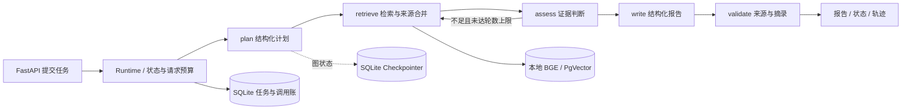

# ResearchPilot

基于 Python、FastAPI 和 LangGraph 的状态化研究与证据溯源 Agent，将资料检索组织为有预算上限、可追踪、可恢复的研究任务。

## 解决的问题

面向技术资料研究和内部知识整理：把问题拆为结构化计划，检索本地资料，判断证据是否充分，必要时有限补检索，再生成附来源与摘录的报告。任务状态、模型调用账和图检查点持久化，便于追踪失败与手动恢复。

## 核心功能

- 五节点 LangGraph：`plan → retrieve → assess → write → validate`，不足时从 assess 返回 retrieve，最多配置 1–3 轮。
- 本地中文 BGE + PgVector；保留英文 ONNX 与 SQLite 词面检索，索引和模型身份显式选择。
- 结构化研究计划、充分性判断、报告 Schema 与来源 ID / 原文摘录校验。
- SQLite Checkpointer、任务状态、节点轨迹、失败/超时处理及手动 `/resume`。
- 本地 Ollama/Qwen 与显式 DeepSeek Provider；持久化请求预算、整任务 deadline、单节点超时和安全错误码。
- FastAPI 文档导入、任务提交、报告、轨迹及恢复接口；Mock 模式可离线演示工程流程。

## 技术栈

Python **3.12** 为已验证环境（包要求 >=3.11,<3.13）；锁定依赖包括 FastAPI **0.151.0**、LangGraph **1.2.16**、LangChain **1.4.6**、Pydantic **2.14.1**、httpx **0.28.1**。使用 SQLite、PostgreSQL / PgVector、FastEmbed / ONNXRuntime，中文模型通过 PyTorch / Transformers / safetensors 加载。

版本与可选依赖见 [pyproject.toml](pyproject.toml)、[基础锁文件](requirements.lock) 和 [中文依赖锁](requirements-chinese.lock)。

## 架构与调用链



真实结构化模型执行计划、证据判断和报告生成；Mock 的候选数量规则只控制演示检索循环，不构成语义充分性判断。来源记录保留文档、分片、检索时间、locator 与查询。

## 关键实现

| 模块 | 设计与边界 |
|---|---|
| [workflow.py](research_pilot/workflow.py) | 真实 StateGraph 与有界回路；结构化初始计划最多生成两条查询，当前首轮使用第一条；验证失败不发布报告 |
| [runtime.py](research_pilot/runtime.py) / [store.py](research_pilot/store.py) | task_id 关联 thread_id；任务表、调用账和检查点对账；进程内防重入，手动恢复 |
| [vector.py](research_pilot/vector.py) | 中文 `BAAI/bge-small-zh-v1.5` 512 维、英文 BGE ONNX 384 维分别存储；校验固定 revision 与资源哈希 |
| [evidence.py](research_pilot/evidence.py) / [local_llm.py](research_pilot/local_llm.py) | 来源白名单、摘录和报告结构校验；`facts_verified=false`，不自动认证事实真实性 |

| Provider | 结构化输出与错误处理 |
|---|---|
| Ollama / Qwen | 本地 OpenAI-compatible 接口；`json_schema`、本地 tokenizer 预算与模型身份预检；显式输出上限，检查截断及 Schema |
| DeepSeek | 显式 `deepseek` 后端、官方 HTTPS 白名单；`json_object` + 本地严格 Pydantic；按应用 UTF-8 字节界限控制输入，不能当作供应商 tokenizer；SDK 无自动重试，分类认证/限流/超时/截断/非法 JSON 错误 |

DeepSeek 共享原图与来源规则，模型名属于服务商别名而非固定权重身份。当前限制为最多 5 次模型调用、300 秒、768 输出 token；预算跨恢复保留，失败尝试也占调用名额。

## 配置与快速启动

在仓库根目录使用 Python 3.12，以下 PowerShell 示例不调用外部模型或搜索：

```powershell
python -m venv .venv
.\.venv\Scripts\python.exe -m pip install -r requirements.lock
.\.venv\Scripts\python.exe -m pip install --no-deps -e .
$env:RESEARCH_MODEL_BACKEND='mock'
$env:RESEARCH_SEARCH_BACKEND='none'
$env:RESEARCH_RETRIEVAL_BACKEND='lexical'
.\.venv\Scripts\python.exe -m uvicorn research_pilot.api:app --host 127.0.0.1 --port 8010
```

打开 `http://127.0.0.1:8010/docs`，或在另一个终端运行 `.\.venv\Scripts\python.exe scripts/smoke_http.py --backend lexical`。默认数据写入被 Git 忽略的 `data/`；程序不会自动读取 `.env`，需向进程环境提供配置。

| 模式 | 必要准备 |
|---|---|
| 中文语义检索 | `requirements-chinese.lock`、固定中文模型缓存、PgVector；设置 `RESEARCH_RETRIEVAL_BACKEND=pgvector`、`RESEARCH_POSTGRES_DSN`、`RESEARCH_EMBEDDING_MODEL=BAAI/bge-small-zh-v1.5` 与独立 `RESEARCH_VECTOR_COLLECTION` |
| Ollama 研究 | 本地 Qwen 权重与 tokenizer；设置 `RESEARCH_MODEL_BACKEND=ollama`、`RESEARCH_OPENAI_BASE_URL=http://127.0.0.1:11434/v1`、`RESEARCH_OPENAI_MODEL=qwen3:4b-instruct-2507-q4_K_M` |
| DeepSeek 研究 | 设置 `RESEARCH_MODEL_BACKEND=deepseek`、官方地址、`RESEARCH_OPENAI_MODEL=deepseek-flash`，仅经进程环境注入 `RESEARCH_OPENAI_API_KEY`；实际运行会产生模型费用 |

完整中文模型下载、独立数据库、模型参数和容器步骤见 [演示指南](docs/DEMO_GUIDE.md)、[配置模板](.env.example) 与 [开发说明](DEVELOPMENT.md)。默认 embedding 仍为英文；切换词面/向量索引或集合后需重新导入文档，不能把旧索引直接当成新模型结果。

## API 示例

```powershell
$base = 'http://127.0.0.1:8010'
$doc = @{title='公开合成笔记'; content='演示组件通过检查点保存单个线程的图状态。使用相同线程标识可以读取此前保存的状态。'; source_ref='synthetic:readme-demo'} | ConvertTo-Json
Invoke-RestMethod -Method Post -Uri "$base/api/documents/text" -ContentType 'application/json; charset=utf-8' -Body ([Text.Encoding]::UTF8.GetBytes($doc))
$request = @{question='演示组件怎样保存单个线程的图状态？'} | ConvertTo-Json
$task = Invoke-RestMethod -Method Post -Uri "$base/api/tasks" -ContentType 'application/json; charset=utf-8' -Body ([Text.Encoding]::UTF8.GetBytes($request))
Invoke-RestMethod "$base/api/tasks/$($task.task_id)"
```

提交返回 202，轮询至 `completed` 后可取 `/api/tasks/{id}/report`；`/trace` 查看节点轨迹，`POST /resume` 手动恢复。未完成任务取报告返回 409；`/health` 是进程状态，不是数据库就绪探针。

## 测试与验证证据

以下为已执行并留档的验证结果，详细范围、失败记录与复核过程见 [测试报告](TEST_REPORT.md)。

| 范围 | 已有结果与口径 |
|---|---|
| 自动化工程回归 | 已记录 78 项回归/合约通过；另有 4 项本地环境补验通过，两次运行分别统计 |
| 本地基础设施 | 真实 LangGraph、独立 TCP HTTP、BGE/PgVector、导入回滚、SQLite 中断/异常/超时/崩溃与手动恢复测试 |
| 中文检索基准 | 20 条合成查询的 Recall@5=1.0；无答案查询仍可能返回候选，**不代表最终回答准确率** |
| 本地 Ollama / Qwen | 已执行真实规划、证据判断和报告生成；部分有证据的问题仍可能过度拒答，复杂证据任务尚未稳定通过 |
| 云端 DeepSeek | 已完成一次公开合成资料的五节点 HTTP 闭环，包含真实 BGE/PgVector、3 次模型请求、报告引用及状态持久化；两条结论由合成原文直接支持，尚未验证本地模型暴露的同类复杂质量问题 |

云端验证中的 Runtime / SQLite / HTTP 重开查询一致，未产生额外模型调用；该次重开不是独立进程崩溃恢复验证。结构化规划冒烟与完整研究流程分别统计。详见 [本地模型验证记录](docs/PHASE71_FINAL_REVIEW.md)、[云端 HTTP 验证记录](docs/PHASE73_DEEPSEEK_HTTP_A.md) 和 [检索基准](benchmarks/zh_retrieval_v1/README.md)。

完整 `python -m pytest -q` 需要额外依赖、本地模型缓存与专用 PostgreSQL；缺环境会失败，不能当成纯 Mock 测试。真实模型用例单独在 `tests_real/`，需另行准备模型与运行环境。

## 已知限制

单实例 FastAPI BackgroundTasks 不是持久队列；不支持多 worker 协调、自动恢复或 exactly-once。任务表与 Checkpointer 是两个 SQLite 文件，没有跨库原子事务；硬退出后可能遗留 running，需显式恢复。Python 线程无法强杀同步 I/O，deadline 拒绝迟到结果仍依赖 Provider 自身超时。

来源 ID、摘录和结构校验不等于语义蕴含或事实验证。不同模型在证据充分性判断与拒答行为上仍有差异，已有小样本验证不足以覆盖全部复杂研究场景。

API 无生产认证，面向本地演示；Tavily 适配未实测，不提供任意网页抓取、Shell/SQL 写工具或通用提示注入防御。

## 来源、许可与文档

项目遵循 [MIT License](LICENSE)，工作流设计参考 [LangChain Open Deep Research](https://github.com/langchain-ai/open_deep_research)，没有复制整库或借用其基准成绩。模型、运行时与设计来源见 [THIRD_PARTY_NOTICES.md](THIRD_PARTY_NOTICES.md)；权重单独下载，不纳入源码发布。AI 辅助实现和个人实际工作应据提交说明。

[架构](ARCHITECTURE.md) · [开发与测试](DEVELOPMENT.md) · [测试报告](TEST_REPORT.md) · [演示](docs/DEMO_GUIDE.md) · [README 修订依据](docs/readme-review.md)
