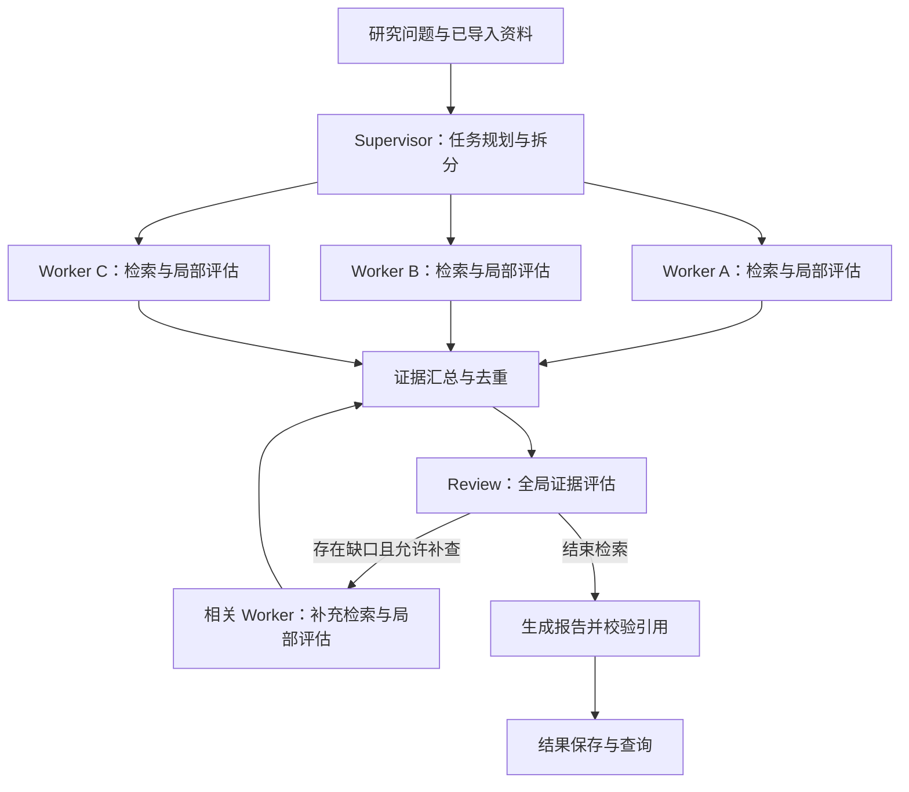
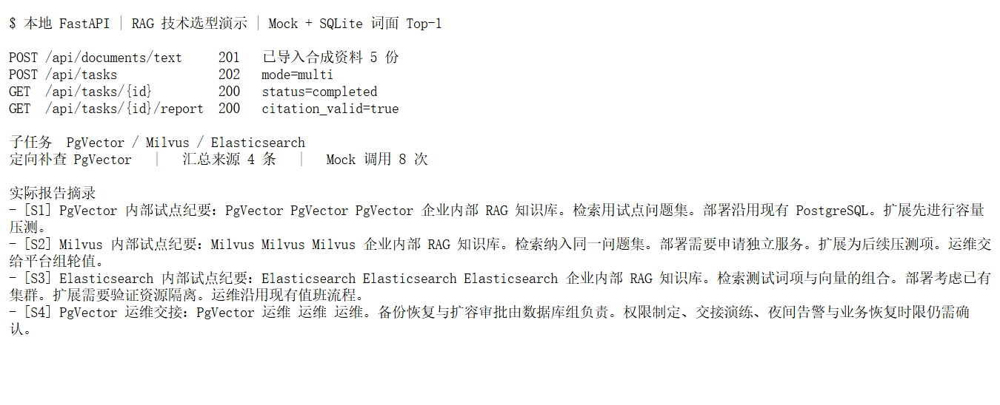
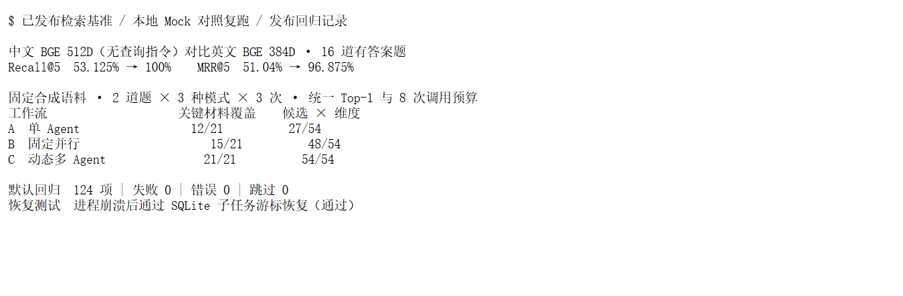

# ResearchPilot：多智能体自主调研与报告生成平台

> AI 应用开发实践 · 企业技术选型与多文档调研

## 一、项目背景与建设目标

企业在建设 RAG 知识库时，通常需要从检索能力、部署成本、扩展能力和运维难度等多个维度，对 PgVector、Milvus 和 Elasticsearch 等候选方案进行综合评估。

相关信息往往分散在技术文档、产品说明和内部试点纪要中。传统人工调研需要反复查阅资料、整理技术指标并核对信息来源。当候选方案和分析维度增加时，容易出现关键资料遗漏、比较维度不统一以及结论缺乏明确依据等问题。

常规 RAG 能够从知识库中检索多个文档的相关内容，但复杂调研任务还需要对研究目标进行拆分，并根据已有证据判断是否需要进一步检索。

基于这一场景，我开发了 ResearchPilot 多智能体自主调研与报告生成平台，将资料检索、任务规划、证据评估和报告生成整合为一套完整的研究工作流。

项目主要围绕以下目标展开：

- **自主任务规划：** 根据用户提出的研究目标，动态拆分研究任务与分析维度。
- **跨文档协同研究：** 调度多个智能体并行检索资料，汇总不同研究方向的证据。
- **动态证据补充：** 根据局部与全局评估结果识别证据缺口，开展定向补充检索。
- **研究报告生成：** 综合检索结果生成结构化报告，提供来源引用、原文摘录及待确认事项。
- **工程化任务管理：** 实现模型调用预算控制、任务状态查询、执行进度持久化及中断恢复。

用户导入研究资料并提交问题后，系统能够自动组织调研过程，最终形成具有统一分析维度和可追溯来源的研究报告。

## 二、系统设计与核心实现

系统基于 Python 和 FastAPI 构建任务服务，通过 LangChain 接入 Ollama 本地 Qwen 模型和远程 DeepSeek API，并使用 Pydantic 对研究计划、证据评估和报告输出进行结构化校验。

工作流采用 LangGraph 进行编排，支持单 Agent 和多 Agent 两种运行模式。单 Agent 模式适用于研究范围相对集中的任务，多 Agent 模式适用于涉及多个候选方案、研究对象或独立分析方向的复杂调研任务。

### 2.1 多智能体任务规划与协同研究

复杂调研任务涉及的研究对象和分析维度通常随用户需求变化，因此系统采用 Supervisor-Worker 架构，实现动态任务拆分与集中式调度。

Supervisor 根据用户的研究目标生成子任务，明确各子任务的研究范围、分析维度和检索查询，并通过 LangGraph 的 `Send` 机制将任务分发给多个 Worker。

各 Worker 在独立的研究子图中执行资料检索与局部证据评估，分别维护检索查询、证据集合和任务执行进度。

并行研究结束后，主流程对各子任务的证据进行汇总与去重，再通过全局评估检查研究维度的覆盖情况及证据缺口。对于仍需补充资料的方向，系统仅调度相关 Worker 开展定向补充检索。

这种设计将任务规划、并行研究和全局质量控制相结合，使系统能够根据不同研究问题动态组织执行过程。

*图 1 多智能体研究工作流（以三个研究子任务为例，全局定向补查最多一批）*

### 2.2 RAG 检索与报告引用校验

系统支持基于 SQLite 的词面检索，以及基于 BGE 和 PgVector 的语义向量检索。

针对中文技术资料的检索需求，引入 BGE-small-zh-v1.5 对文档片段进行向量编码，通过 PgVector 完成相似度检索，并将相关文档片段提供给 Worker 进行证据分析。

研究过程中，各 Worker 根据子任务目标获取相关资料，通过证据评估判断当前检索结果能够支持哪些研究结论，以及哪些分析维度仍需补充。

报告生成阶段，系统将汇总后的研究证据与用户要求共同提供给大模型，生成包含研究结论、来源引用、原文摘录和待确认事项的结构化报告。

在报告发布前，通过程序逐条核对引用的来源 ID 和原文摘录，建立研究结论与原始资料之间的追溯关系，便于用户进一步核对和使用研究结果。

### 2.3 模型接入与共享预算控制

考虑到本地开发、模型验证及不同部署环境的需求，系统通过统一的模型调用层支持本地 Qwen、远程 DeepSeek API 和 Mock 模型。

本地 Qwen 用于真实模型验证，DeepSeek API 提供远程模型接入能力，Mock 模型用于可重复的工作流测试、对照实验和故障恢复验证。

多智能体并行执行涉及多个模型调用环节。为了统一管理整个研究任务的资源消耗，系统基于 SQLite 事务实现共享调用额度的原子检查与扣减，并为全局评估和报告生成预留调用次数。

同时设置模型调用次数、检索轮次、Worker 并发数量及任务执行时限等约束，使任务规划、并行研究、证据补充和报告生成能够在统一的资源预算下运行。

### 2.4 工作流状态持久化与中断恢复

研究任务通常包含多个检索和模型调用环节，具有较长的执行链路。因此，系统结合 LangGraph Checkpointer 和 SQLite 实现工作流检查点、子任务执行进度及共享预算的持久化。

当运行进程发生异常中断时，可以通过恢复接口继续执行任务，复用已经保存的检索结果与已完成的子任务，并沿用剩余调用预算。

通过 FastAPI 提供任务提交、状态查询、报告查询和任务恢复等接口，用户能够查看研究任务的执行阶段、子任务进度和最终报告。

[详细技术架构与执行流程](MULTI_AGENT_FLOW_ZH.md)

## 三、AI 辅助开发实践

项目开发过程中，我使用 ChatGPT 和 OpenAI Codex 辅助完成需求分析、技术方案设计、代码实现、问题定位与工程测试，并结合实际运行结果持续优化系统。

### 3.1 需求分析与架构设计

在设计阶段，我使用 ChatGPT 分析企业技术选型场景，将原本需要人工完成的多资料查阅、候选方案比较和证据核对过程，转化为可执行的智能体研究任务。

围绕复杂调研任务的组织方式，分析固定并行工作流与动态任务拆分的设计差异，形成以 Supervisor-Worker 为核心的多智能体架构。

进一步明确各模块的职责：Supervisor 负责研究规划，Worker 负责子任务检索和局部证据评估，Review 负责全局证据检查，报告生成模块负责综合研究结果。

同时，将共享预算控制、子任务独立执行、定向补充检索和中断恢复等需求转化为具体的工程实现目标与可测试的验收项。

### 3.2 工作流实现与代码开发

在实现阶段，我使用 OpenAI Codex 辅助完成 LangGraph 工作流改造、研究子图实现、动态任务分发、共享预算管理和任务恢复机制的开发。

将复杂开发任务拆分为独立的实现与验证环节，结合运行结果逐步完善节点职责、状态传递、条件路由以及异常处理逻辑。

针对多个 Worker 并行调用模型的场景，通过并发测试验证共享调用额度的原子性；针对长时间研究任务，通过模拟进程异常退出，检查工作流检查点、子任务执行进度及证据保存情况，验证任务恢复机制。

### 3.3 真实模型调试与质量优化

在真实模型验证阶段，使用本地 Qwen 执行研究规划、证据评估和报告生成任务，并将生成结论与检索到的原始资料逐条对照。

围绕候选方案覆盖、检索查询相关性、证据充分性以及报告引用一致性等问题，对工作流和模型提示词进行针对性调整。

通过 ChatGPT 辅助分析问题产生的原因和优化思路，结合 Codex 完成相应代码修改及测试补充，再通过本地运行结果验证调整效果。

整个开发过程形成了需求分析、方案设计、代码实现、运行验证和持续优化的工程闭环，使 AI 工具贯穿从应用设计到功能交付的各个阶段。

[工程验收与测试记录](MULTI_AGENT_ACCEPTANCE_ZH.md)

## 四、应用演示与项目成果

### 4.1 企业 RAG 知识库技术选型演示

以企业建设 RAG 知识库为例，用户希望综合比较 PgVector、Milvus 和 Elasticsearch 的技术特点、部署要求及运维成本。

通过 FastAPI 导入合成试点资料并提交研究任务后，Supervisor 根据研究目标生成三个子任务，由不同 Worker 分别围绕 PgVector、Milvus 和 Elasticsearch 开展资料检索和证据评估。

系统汇总各子任务的研究结果后，通过全局评估发现 PgVector 方向的运维资料仍需补充，因此仅对该方向发起定向补充检索。

完成补充检索后，系统综合各候选方案的研究证据生成报告，并完成 4 条来源引用的校验。

*图 2 本地 HTTP 接口运行结果（Mock 模型与合成试点资料）*

### 4.2 检索质量与多智能体编排评测

为验证系统的检索能力、多智能体协作效果及工程稳定性，项目分别开展了中文语义检索评测、多智能体工作流对照实验和自动化回归测试。

| 验证内容 | 实际结果 |
|---|---|
| 中文语义检索 | 在包含 19 篇测试文档的固定语料上，对 16 道有答案题进行评测。中文 BGE（512 维，无查询指令）相较英文 BGE（384 维），Recall@5 从 **53.125% 提升至 100%**，MRR@5 从 **51.04% 提升至 96.875%**。[实验记录](../benchmarks/zh_retrieval_v1/README.md) |
| 多智能体编排 | 两道合成选型题共运行 18 次 Mock 对照实验。各组使用相同资料、Top-1 检索和 8 次调用预算。单 Agent、固定并行、动态多 Agent 的关键材料覆盖分别为 **12/21、15/21、21/21**。[实验记录](../benchmarks/multi_agent_v1/README.md) |
| 回归测试与恢复 | **124 项默认回归测试全部通过**。在独立进程崩溃测试中，重启运行时并调用恢复接口后，已完成子任务得到保留，未完成子任务继续执行，已保存的检索结果可复用。[测试源码](../tests/test_multi_agent.py#L330) |

中文检索评测验证了中文 Embedding 模型对测试语料的适配效果；多智能体对照实验则展示了动态任务规划与定向补充检索在关键材料覆盖方面的作用。

*图 3 检索评测、多 Agent 对照实验及发布验收结果*

本地 Qwen 的真实模型评测进一步记录了材料覆盖、引用校验结果及逐条人工复核结论，为后续模型适配与报告质量优化提供依据。

[真实模型评测记录](../benchmarks/multi_agent_v1/REAL_QWEN_REVIEW_20261125.md)

### 4.3 项目成果与应用价值

ResearchPilot 将复杂的跨文档调研过程转化为可执行、可查询、可恢复的多智能体研究任务，形成从资料导入、任务规划、并行研究、证据评估到报告生成的完整应用链路。

在企业技术选型场景中，系统能够辅助研究人员围绕多个候选方案开展统一维度的资料分析，根据证据缺口进行定向补充检索，并通过来源引用和原文摘录支持后续人工核对。

该架构也可应用于产品方案对比、技术趋势分析、内部知识调研和多文档综合分析等场景。

项目将 Multi-Agent、Workflow、RAG 与后端任务管理机制相结合，完成了从业务需求分析、AI 辅助开发到系统实现和工程验证的完整实践。

[项目主页与运行方式](../README.md)
