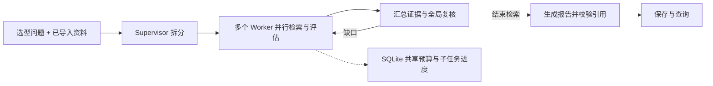

# ResearchPilot · AI 应用开发实践

**企业技术选型与多文档调研。** 以 PgVector、Milvus 和 Elasticsearch 的选型为例，输入问题与多份试点纪要后，系统按候选分工检索，针对缺口补查，输出带来源、原文摘录和待确认事项的报告。

## 做了什么

用 **FastAPI** 接收任务，用 **LangGraph** 编排研究。默认单 Agent 处理较简单的问题。多 Agent 模式由 Supervisor 拆分任务，各 Worker 独立检索和评估，再汇总证据。检索可使用中文 **BGE + PgVector** 或 SQLite 词面检索。模型调用前在 **SQLite** 预占共享额度，进程中断后可从已保存的子任务进度手动恢复。[源码与流程](MULTI_AGENT_FLOW_ZH.md)

## 如何使用 AI 辅助开发

- **ChatGPT** 用于梳理企业选型需求，讨论任务拆分、证据要求和恢复边界，并把「验证效果」明确为检索、编排和报告三类验收。
- **OpenAI Codex** 在仓库内辅助编写代码、运行测试和排查故障。例如，检查进程崩溃时保存的子任务进度，对照 Qwen 报告和原文复核引用与结论。[工程验收](MULTI_AGENT_ACCEPTANCE_ZH.md)

## 实际运行与可量化结果

| 验证项目 | 结果与条件 |
|---|---|
| 中文检索 | Recall@5 **53.125% → 100%**，MRR@5 **51.04% → 96.875%**。英文 BGE 384 维对比中文 BGE 512 维无查询指令，基于固定合成集的 16 道有答案题。[记录](../benchmarks/zh_retrieval_v1/README.md) |
| 多 Agent 编排 | 关键材料覆盖 **12/21 → 15/21 → 21/21**（单 Agent、固定并行、动态多 Agent）。两道合成选型题共 18 次 Mock，使用相同资料、Top-1 和 8 次调用预算。[记录](../benchmarks/multi_agent_v1/README.md) |
| 工程回归与恢复 | **124 项默认回归通过**。独立进程崩溃测试验证了手动恢复、复用已保存检索，以及只重新执行未完成的子任务。[测试源码](../tests/test_multi_agent.py#L330) |

*本地真实 HTTP 运行。使用 Mock 和合成资料，PgVector 收到一次定向补查，报告列出了 4 条来源引用。*

*检索与回归取自发布记录，Mock 对照在本地复跑。覆盖率衡量的是固定样本上的检索与编排。*

真实 Qwen 的单次 RAG 复查中，7 条引用均匹配原文，人工严格复核只有 1 条结论完整相关且获证，系统保留了部分报告状态。[逐条复核](../benchmarks/multi_agent_v1/REAL_QWEN_REVIEW_20261125.md)
