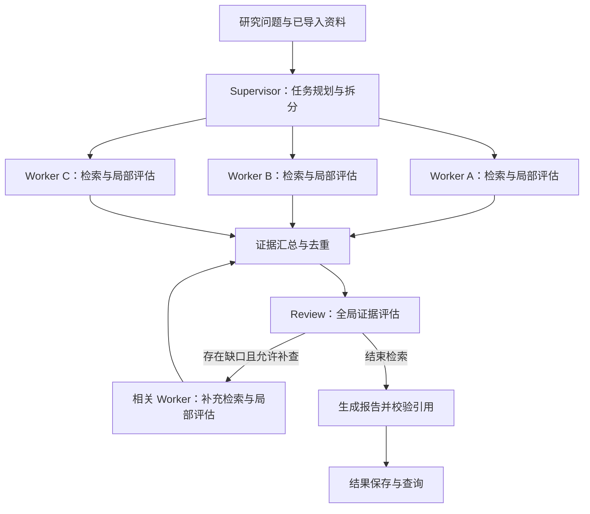

# ResearchPilot：多智能体自主调研与报告生成平台

> AI 应用开发实践 · 企业技术选型与多文档调研

## 项目背景与应用场景

企业建设 RAG 知识库时，需要从检索能力、部署成本、扩展能力和运维难度等方面比较 PgVector、Milvus 和 Elasticsearch。相关信息分散在技术文档与内部试点纪要中。评审人员既要把各方案放在同一维度下比较，也要能回到原文核对结论。

ResearchPilot 将这类调研组织为可查询、可恢复的任务。用户导入资料并提交问题与研究范围后，系统按候选方案分别检索，针对证据缺口补查，最终生成附有来源、原文摘录和待确认事项的报告。

## 系统设计与核心实现

系统以 Python 和 FastAPI 提供任务接口，通过 LangChain 接入本地 Qwen、DeepSeek 等模型，并用 Pydantic 校验计划、评估与报告的结构。LangGraph 负责流程编排。默认单 Agent 模式在同一上下文中完成调研，多 Agent 模式适用于需要按候选方案或独立研究方向分工的任务。

- **分工与补查。** Supervisor 按研究目标拆分任务，通过 LangGraph 的 `Send` 分发给多个 Worker。各 Worker 在独立子图中检索和评估资料。主流程合并证据、去除重复来源，并根据全局评估结果向相关 Worker 发起定向补查。
- **检索与报告。** 中文资料可使用 BGE 和 PgVector 进行语义检索，也可使用 SQLite 进行词面检索。报告引用须对应本轮检索结果，系统逐条核对来源 ID 和原文摘录，并在报告中标出仍待确认的事项。
- **预算与恢复。** 模型请求发出前，通过 SQLite 事务预占共享额度，并为全局评估和报告生成预留调用次数。进程中断后，可通过恢复接口从流程检查点和子任务进度继续执行，复用已保存的检索结果及已完成的子任务。

*图 1 多智能体研究工作流（以三个研究子任务为例，全局定向补查最多一批）*

[详细技术架构与执行流程](MULTI_AGENT_FLOW_ZH.md)

## AI 辅助开发实践

设计阶段，我用 ChatGPT 梳理企业调研的需求，把“比较多个候选方案”拆成可并行的研究任务。子任务评估现有资料能支持哪些结论，全局评估判断整份报告还缺什么。我也把共享预算与中断恢复转化为可测试的验收项。

实现阶段，我用 OpenAI Codex 辅助改造工作流、补充测试和定位问题。通过并发测试检查调用额度是否会被超扣，通过模拟进程异常退出核对恢复前后的子任务状态，确认已保存的证据可复用。调试本地 Qwen 报告时，我还将结论与原文逐条对照，分别检查引用匹配和证据支持情况。

[工程验收与测试记录](MULTI_AGENT_ACCEPTANCE_ZH.md)

## 应用演示与项目成果

在企业 RAG 知识库选型演示中，通过 FastAPI 导入合成试点资料并提交任务后，三个 Worker 分别检索 PgVector、Milvus 和 Elasticsearch。全局评估发现 PgVector 的运维资料不足，随后只对这个方向补查，最终生成含 4 条来源引用的报告。

*图 2 本地 HTTP 接口运行结果（Mock 模型与合成试点资料）*

| 验证内容 | 实际结果 |
|---|---|
| 中文语义检索 | 在包含 19 篇测试文档的固定语料上，对 16 道有答案题进行评测。中文 BGE（512 维，无查询指令）相较英文 BGE（384 维），Recall@5 从 **53.125% 升至 100%**，MRR@5 从 **51.04% 升至 96.875%**。[实验记录](../benchmarks/zh_retrieval_v1/README.md) |
| 多智能体编排 | 两道合成选型题共运行 18 次 Mock 对照。各组使用相同资料、Top-1 检索和 8 次调用预算。单 Agent、固定并行、动态多 Agent 的关键材料覆盖分别为 **12/21、15/21、21/21**。[实验记录](../benchmarks/multi_agent_v1/README.md) |
| 回归测试与恢复 | **124 项默认回归测试全部通过**。在独立进程崩溃测试中，重启运行时并调用恢复接口后，已完成子任务得到保留，未完成子任务继续执行，已保存的检索结果可复用。[测试源码](../tests/test_multi_agent.py#L330) |

*图 3 检索评测、多 Agent 对照实验及发布验收结果*

本地 Qwen 的真实模型评测另行记录了材料覆盖、引用校验结果与逐条人工复核结论。[真实模型评测记录](../benchmarks/multi_agent_v1/REAL_QWEN_REVIEW_20261125.md)

[项目主页与运行方式](../README.md)
